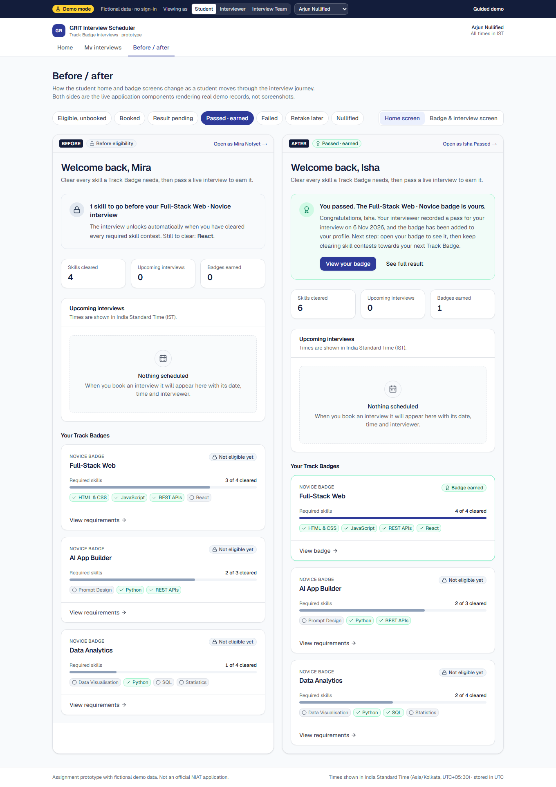

# GRIT Interview Scheduler

An end-to-end interview scheduling workflow for Track Badge interviews in NIAT's GRIT competition, built by **Rahul Upadhyay** as an individual submission for the **AI Product Engineer assignment (Round 1)**.

Students who clear every skill a Track Badge requires book a live interview; interviewers offer availability and record pass / fail / retake later; the interview team sees who is eligible, who has booked, what is waiting on a result, and can nullify a badge when malpractice is confirmed.

> This is an assignment prototype with fictional demo data. It is not an official NIAT application, and the booking policies in it are my assumptions, not NIAT rules.



## Quick start

Requires Node.js 20.9 or newer (developed on Node 24) and npm.

```bash
git clone https://github.com/RKU1327/grit-interview-scheduler.git
cd grit-interview-scheduler
npm install
npm run dev
```

Open <http://localhost:3000>. That is all: on the first request the app creates `data/grit.db`, applies the migrations and seeds the demo data. No environment variables, accounts, API keys or external services are needed.

To explore, open **Guided demo** in the dark bar at the top (<http://localhost:3000/demo>). It lists eight steps that walk the whole workflow and has the **Reset demo data** button.

## Deliverables

| Deliverable | Where |
| --- | --- |
| Two-page write-up (states, edge cases, data model) | [`docs/GRIT_Assignment_Writeup.pdf`](docs/GRIT_Assignment_Writeup.pdf) · source [`docs/GRIT_Assignment_Writeup.md`](docs/GRIT_Assignment_Writeup.md) |
| Working prototype | This repository |
| Three key student messages, exact wording | [`docs/Student_Messages.md`](docs/Student_Messages.md) · rendered from [`src/lib/messages.ts`](src/lib/messages.ts) |
| Before / after screens | In the app at `/student/preview` · [`docs/screenshots/`](docs/screenshots/) |
| Loom talk track (recording still to be made) | [`docs/Loom_Walkthrough.md`](docs/Loom_Walkthrough.md) |
| Submission checklist and known limitations | [`docs/Submission_Checklist.md`](docs/Submission_Checklist.md) |

## Demo mode

There is no sign-in. The dark bar at the top of every page switches between three personas and, for students and interviewers, which person you are:

| Persona | Home | What it covers |
| --- | --- | --- |
| Student | `/student` | Progress, eligibility, booking, managing a booking, results, before / after |
| Interviewer | `/interviewer` | Daily schedule, availability, interview detail, recording outcomes |
| Interview Team | `/team` | Overview, eligible-student roster, all appointments, badges and nullification, activity log |

Seeded students are named after the state they demonstrate:

| Student | State |
| --- | --- |
| Mira Notyet | Not yet eligible (one skill short) |
| Kabir Eligible | Just became eligible, not booked |
| Tara Booked | Interview booked for tomorrow |
| Dev Pending | Interview happened yesterday, outcome pending |
| Isha Passed | Passed, badge earned |
| Rohan Failed | Failed |
| Neha Retake | Retake later, can re-book |
| Arjun Nullified | Badge earned, later nullified for malpractice |
| Zoya Secondtry | Failed attempt 1, team opened attempt 2, which is booked |
| Sam Unbooked | Eligible, booked once, cancelled |
| Lina Rescheduled | Booked after a reschedule |
| Pia Noshow | No-show, needs to re-book |
| Omar Earlystage | One skill cleared |

Seed dates are relative to the moment you seed, so "tomorrow" is always tomorrow.

**Demo clock.** A result cannot be recorded before an interview starts. So that you can book a slot and then record its result in one sitting, the interview page has a "Demo: jump clock to interview start" button. The shifted time is shown in the top bar; "Back to real time" and "Reset demo data" are on the Guided demo page.

## The seven workflows

1. **Eligibility to booking.** As Mira, open the Full-Stack Web badge, use the demo control to clear "React", book a slot. It appears on that interviewer's schedule and on the team roster.
2. **Pass.** As Priya Panelist, record Pass for Dev Pending (already awaiting a result). Dev's home and badge screens show the badge; the team overview updates.
3. **Fail.** Record Fail instead. The attempt stays in history; the student is told a new attempt opens only if the team allows one. The team can open one from the student record.
4. **Retake later.** Record Retake later with a wait. The student sees a distinct message and the date booking re-opens.
5. **Reschedule / cancel.** As Tara, reschedule or cancel. The original row stays in history, the slot is released, and interviewer and team views update.
6. **Malpractice.** As the Interview Team, Badges, nullify Isha's badge with a reason. The student sees "badge nullified"; the pass and the award remain in the audit history.
7. **Before / after.** As any student, open "Before / after".

## Pages

| Route | Purpose |
| --- | --- |
| `/demo` | Guided demo, reset, demo clock |
| `/student` | Home: key message, upcoming interviews, Track Badges |
| `/student/badges/[slug]` | Badge and interview detail: journey steps, booking, history, skills |
| `/student/badges/[slug]/book` | Slot picker (also used for rescheduling) |
| `/student/interviews` | Current bookings, full booking history, rules |
| `/student/results/[attemptId]` | Result screen for one attempt |
| `/student/preview` | Before / after comparison using live components |
| `/interviewer` | Daily schedule with date navigation and the outcome-pending queue |
| `/interviewer/availability` | Create, edit and remove availability windows |
| `/interviewer/interviews/[id]` | Interview context and outcome recording |
| `/team` | Overview: eligible, unbooked, booked, pending, completed, results breakdown |
| `/team/roster` | Eligible students with booked / unbooked filters and search |
| `/team/appointments`, `/team/appointments/[id]` | All appointments, outcome review and corrections |
| `/team/badges` | Issued badges and malpractice nullification |
| `/team/students/[id]` | One student's badges, attempts and activity history |
| `/team/activity` | Audit trail |

## Design in one minute

The workflow is modelled as **four separate lifecycles**, not one status:

| Lifecycle | States |
| --- | --- |
| Eligibility | locked → eligible |
| Appointment | scheduled → completed / cancelled / rescheduled / no_show / interviewer_absent |
| Attempt and outcome | awaiting_interview → awaiting_outcome → passed / failed / retake_later |
| Badge | not_earned → earned → nullified |

An *attempt* ends in exactly one result and can own several *appointments* (reschedules, cancellations and no-shows never count as a result). What a screen shows, the "journey state", is derived from these four and never stored. The full reasoning is in the [write-up](docs/GRIT_Assignment_Writeup.pdf).

### Prototype policy

These are assumptions made so the workflow is demonstrable. They live in one file, [`src/domain/policy.ts`](src/domain/policy.ts).

- Slots are 30 minutes and must be booked at least 30 minutes ahead.
- Students can cancel or reschedule until 2 hours before the start, with at most 2 reschedules per attempt.
- After **retake later**, the student re-books themselves from a date the interviewer sets (0, 3, 7 or 14 days).
- After **fail**, a new attempt opens only when the interview team grants one.
- A student no-show or an interviewer absence closes the slot with no result; the attempt stays open.
- A nullified badge cannot be re-booked.
- Interviewers cannot change a published outcome. The team can correct fail ↔ retake or either to pass, with a reason. A pass is only ever removed by nullification.

## Architecture

```
src/
  db/
    schema.ts        Drizzle schema: 16 tables, checks, partial unique indexes
    index.ts         Connection, pragmas, migrate-on-open, seed-if-empty
    seed-data.ts     Demo fixtures, created by calling the real services
  domain/            Framework-free business logic (unit + integration tested)
    policy.ts        Constants, state machines, booking gate, journey projection
    core.ts          Demo clock, audit helper, transaction helper, badge context
    eligibility.ts   Skill completion -> eligibility
    booking.ts       Slots, book, cancel, reschedule, conducted, no-show
    outcomes.ts      Record outcome, award badge, corrections
    badges.ts        Nullification, re-attempt grants
    availability.ts  Windows with overlap and booking-conflict handling
    queries.ts       Read models for every screen
  app/
    actions.ts       Server actions: persona + role check, error mapping
    student/ interviewer/ team/ demo/   Routes (server components)
  components/        UI: app shell, student, staff, shadcn/ui primitives
  lib/               time (IST formatting), messages, persona cookie
drizzle/             Generated SQL migration
tests/               unit, integration (in-memory SQLite), e2e (Playwright)
scripts/             migrate, seed, PDF build, screenshots, packaging
```

Key points:

- **Server components read, server actions write.** Every mutation goes through `src/app/actions.ts`, which resolves the acting persona, checks the role, calls a domain service, and maps domain errors to messages.
- **Critical writes are transactional.** Booking, rescheduling, outcomes, nullification and availability changes each run in one `BEGIN IMMEDIATE` transaction that re-validates before writing. Partial unique indexes back them up at the database level.
- **Idempotent by design.** Booking takes a client idempotency key; repeating an outcome, a cancel, a nullification or a skill completion is a no-op rather than a duplicate.
- **Nothing is overwritten.** Outcomes are an append-only ledger, reschedules link to the row they replace, and every transition writes an audit event in the same transaction.
- **Time.** UTC ISO strings in storage, IST (Asia/Kolkata) everywhere in the UI, always labelled. Formatting happens on the server, so the viewer's own time zone cannot change what they see.

### Decisions worth explaining

- **Dynamic rendering.** `create-next-app` now enables Cache Components by default. Every screen here is live per-persona data, where stale output would be a correctness bug, so I turned it off and render dynamically.
- **better-sqlite3.** Synchronous, in-process SQLite makes the transaction code short and easy to verify. It ships prebuilt binaries for current Node versions on Windows, macOS and Linux.
- **shadcn/ui (Base UI flavour).** Dialogs, buttons, inputs and toasts come from shadcn/ui. Simple filters and pickers use native controls for keyboard and screen-reader behaviour.
- **SQLite limits.** There is no range-exclusion constraint, so "no overlapping bookings" relies on fixed 30-minute slots, a unique index on (interviewer, start), and SQLite's single writer. On Postgres I would use an exclusion constraint.

## Stack

| | Version |
| --- | --- |
| Next.js (App Router, Turbopack) | 16.4 |
| React | 19.3 |
| TypeScript (strict) | 5.x |
| Tailwind CSS | 4.3 |
| shadcn/ui on Base UI, Lucide icons, Sonner toasts | shadcn 4.x |
| SQLite via better-sqlite3 | 13.x |
| Drizzle ORM / drizzle-kit | 0.45 / 0.31 |
| date-fns + date-fns-tz | 4.x / 3.x |
| Vitest, Playwright | 5.x / 1.65 |

Exact versions are pinned in `package-lock.json`.

## Commands

| Command | What it does |
| --- | --- |
| `npm run dev` | Start the dev server on port 3000 |
| `npm run build` / `npm start` | Production build and server |
| `npm run db:migrate` | Apply migrations to `data/grit.db` |
| `npm run db:seed` | Wipe and re-seed the demo data |
| `npm run db:setup` | Migrate, then seed |
| `npm run db:generate` | Regenerate SQL migrations after a schema change |
| `npm run lint` | ESLint |
| `npm run typecheck` | `tsc --noEmit` |
| `npm test` | Unit and integration tests (Vitest, in-memory SQLite) |
| `npm run test:e2e` | Playwright end-to-end tests |
| `npm run check` | lint, typecheck, tests and build |
| `npm run docs:pdf` | Build the write-up PDF and fail if it exceeds two pages |
| `npm run screenshots` | Capture `docs/screenshots` from a running app |
| `npm run package` | Create `submission/grit-interview-scheduler.zip` from the committed tree |

The database location can be changed with `DATABASE_URL=./path/to/file.db`.

### Tests

- **Unit** (`tests/unit`): eligibility calculation, every state machine, the booking gate, the journey projection, change-window timing, IST date boundaries, and the message wording against the docs.
- **Integration** (`tests/integration`): database-backed workflows on in-memory SQLite: booking conflicts and idempotency, the database-level unique indexes, cancel and reschedule, outcomes and corrections, fail vs retake, no-shows, nullification, availability overlap and conflict resolution, and that the seed matches the dashboard numbers.
- **End to end** (`tests/e2e`): ten Playwright tests against a production build with its own database (`data/e2e.db`, port 3100): the seven workflows, availability protection, persona separation with a console-error check, and a mobile overflow check. The browser runs in New York time to prove the UI does not depend on the viewer's zone.

First-time Playwright setup: `npx playwright install chromium`.

## Limitations and future work

Implemented behaviour is described above. Not built:

- Real authentication and authorisation (the persona cookie is a stand-in; server actions still check role and ownership).
- Notifications, calendar invites and a meeting link. Messages are in-app only.
- Recurring availability rules; interviewers add dated windows.
- Badge tier ordering and Miles. Eligibility is "all required skills cleared".
- Hosted deployment. SQLite on a local file suits a prototype; a hosted version would move to Postgres.
- Reversing a nullification, and bulk team actions.

## Credits

Built by Rahul Upadhyay as an individual assignment, using Claude Code as an AI pair programmer. Terminology (Track Badge, skill contests, tiers) follows the public GRIT pages; everything else, including all names and data, is fictional.
